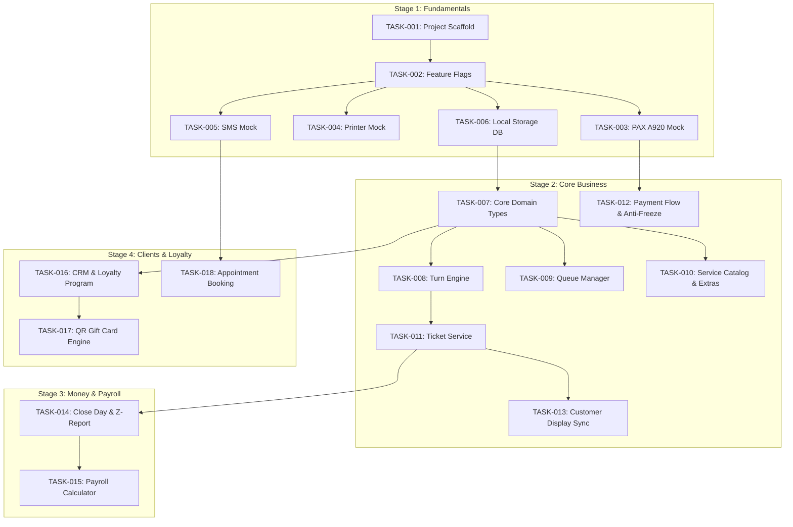

# BÁO CÁO PHÂN TÍCH & KẾ HOẠCH TRIỂN KHAI HOÀN THIỆN DỰ ÁN NAILS-POS

> **Trạng thái:** ĐÃ HOÀN TẤT LÀM RÕ NGHIỆP VỤ (CHỦ DỰ ÁN ĐÃ PHÊ DUYỆT CÁC CÂU HỎI)  
> **Điều phối viên:** Coordinator Agent  
> **Tài liệu tham chiếu:**  
> - `idea/nails-pos/requirement.md`  
> - `idea/nails-pos/Giai-doan-0.md`  
> - `idea/nails-pos/Stage-0-Prep.md`  
> - `idea/nails-pos/Stage-1-Fundamentals.md`  
> - `idea/nails-pos/Stage-2-Core.md`  
> - `idea/nails-pos/Stage-3-Money.md`  
> - `idea/nails-pos/Stage-4-Clients.md`  
> - Tham chiếu hệ thống thực tế: `https://macmarketing.us/abc-salon-system`

---

## PHẦN 1: TỔNG HỢP NGUYÊN TẮC NGHIỆP VỤ ĐÃ CHỐT

### 1. Phần cứng & Môi trường vận hành (Stage 0 & 1)
- **Môi trường chạy chính:** Chạy trên **Windows trước** (máy POS tại quầy), kiến trúc Web Browser khổ ngang (Tablet/Desktop Landscape) kết hợp Local Backend Node.js nhẹ để quản lý dữ liệu và giao tiếp socket mạng nội bộ. Sẵn sàng mở rộng sang iPad / Android Tablet sau này.
- **Máy cà thẻ (Payment Terminal):** Dòng **5.5” PAX A920** (tham khảo hệ thống ABC Salon System). Kết nối qua mạng WiFi/LAN nội bộ với router tiệm (Linksys E2500).
- **Lỗi đơ máy cà thẻ (Field Bug):** Thường xảy ra ở bước: *Chọn thanh toán thẻ trên POS > Lễ tân xác nhận số tiền > Máy PAX nhận lệnh và chuyển sang màn hình chọn Tip cho khách thì bị đơ*.
  - *Giải pháp phần mềm:* Cung cấp nút Cancel cưỡng chế từ máy POS (Mac/Windows), thiết lập cơ chế Timeout và Heartbeat để hủy lệnh an toàn, tránh treo giao dịch.
- **Dual Screen (Màn hình phụ cho khách - Customer Display):** Màn hình chính trong quầy cho lễ tân/quản lý chọn dịch vụ, màn hình thứ 2 quay ra ngoài hiển thị chi tiết dịch vụ, tổng tiền và trạng thái thanh toán đồng bộ thời gian thực qua Web BroadcastChannel.
- **Máy in hóa đơn (Receipt Printer):** Máy in nhiệt chuẩn khổ 80mm/58mm kết nối mạng LAN hoặc USB.
- **SMS Gateway:** Twilio hoặc dịch vụ tương đương (giai đoạn đầu sử dụng Mock Service để lưu log và kiểm thử).

### 2. Thuật toán chia Lượt thợ (Turn Engine) — Các quy tắc cốt lõi
1. **Ưu tiên 1 (Arrival / Clock-in):** Thứ tự thợ vào tiệm trong ngày (ai vào trước đứng trước trong hàng đợi rảnh).
2. **Ưu tiên 2 (Turn Count):** Người đang có ít turn hơn được ưu tiên nhận khách tiếp theo.
3. **Ưu tiên 3 (Skill & Duration):** Khi tất cả thợ đều bận, khách mới yêu cầu dịch vụ X sẽ được gán cho thợ có kỹ năng làm dịch vụ X có thời gian dự kiến hoàn thành sớm nhất.
4. **Quy tắc Khách chỉ định (Request):** Khách do thợ tự mang về (yêu cầu đích danh thợ). **KHÔNG tính là 1 turn thông thường và KHÔNG đẩy thợ xuống đáy danh sách rảnh**. Thứ tự ưu tiên turn của thợ vẫn được bảo lưu.
5. **Dịch vụ dưới ngưỡng sàn (< $35):** Không tính là 1 turn, không cộng dồn tiền để tích thành turn. Lượt này được **rải từ dưới lên** (dành cho thợ rảnh ở vị trí cuối cùng trong danh sách thợ đang rảnh đi ngược lên).
6. **Khách hủy dịch vụ giữa chừng (trong 5 phút đầu):** Đưa thợ đó trở lại **vị trí đầu tiên** của danh sách thợ đang rảnh.
7. **Khách làm Combo (2 thợ cùng làm tay + chân):** Tạm thời xét theo ai xong sớm hơn để quyết định turn tiếp theo; dịch vụ nào dưới $35 ưu tiên thợ đó.
8. **Quyền Quản lý (Manual Override):** Chủ tiệm / Quản lý có quyền kéo-thả đổi lượt thủ công bằng tay — **quyền này là cao nhất**, hệ thống tôn trọng ghi đè.

### 3. Quy tắc Tài chính & Tiền lương (Stage 3 - Money)
- **Phí quẹt thẻ (Card Processing Fee):** Tiệm chịu hoàn toàn, **không thu phụ phí (surcharge)** từ khách, không trừ vào hoa hồng thợ.
- **Tỷ lệ ăn chia (Commission):** Mặc định là **60/40** (thợ nhận 60%, tiệm nhận 40%), có thể cấu hình linh hoạt theo từng thợ.
- **Tiền chi phí vật liệu (Supply Fee):** Để tùy chọn (optional) ở từng dịch vụ do chủ tiệm cấu hình (nếu có, sẽ trừ trước khi chia % hoa hồng).
- **Tiền Tip:**
  - *Tip tiền mặt:* Khách đưa trực tiếp cho thợ, chia ngay tại chỗ, hệ thống không can thiệp.
  - *Tip qua thẻ:* Khách tip trong thẻ, chủ tiệm sau khi trừ phần phí thẻ (card fee % do tiệm quy định) sẽ hoàn trả lại cho thợ.
- **Hình thức thanh toán thợ:** Tiền đến bằng hình thức nào trả bằng hình thức đó (tiền mặt trả tiền mặt; tiền thẻ trả bằng Check hoặc Direct Deposit).

### 4. Khách hàng, Đặt lịch & Loyalty (Stage 4 - Clients)
- **Đặt lịch (Booking):** Hỗ trợ 2 luồng: Lễ tân đặt tại quầy khi khách gọi điện thoại, và khách tự đặt online qua trang web. **Không yêu cầu đặt cọc (Deposit)**.
- **Tích điểm thưởng (Loyalty):** Tích lũy theo tổng tiền chi tiêu đạt ngưỡng (ví dụ: chi đủ $300 được giảm $10), tiệm tự thiết lập cấu hình.
- **Gift Card:** Sinh mã Unique Code và hiển thị mã **QR Code**. Chủ tiệm tự in thẻ giấy có mã QR; khi khách đến thanh toán chỉ cần quét mã QR để trừ số dư.

---

## PHẦN 2: DANH SÁCH ATOMIC TASKS CHÍNH THỨC

Toàn bộ kế hoạch được chia thành các **Atomic Tasks** độc lập, tuần tự theo quy chuẩn của Coordinator:
- Mỗi task chạm **đúng 1 file hoặc 1 module**.
- Có tiêu chuẩn nghiệm thu độc lập và tự kiểm thử (Unit test/CLI verify xanh).
- Two-way door (dễ hoàn nguyên an toàn bằng `git checkout .`).

---

### GIAI ĐOẠN 1: FUNDAMENTALS (NỀN TẢNG KỸ THUẬT & ADAPTER MOCKS)

- [ ] **TASK-001**: Khởi tạo cấu trúc dự án TypeScript + Node.js runtime tại `idea/nails-pos`  
  — **File:** `idea/nails-pos/package.json`  
  — **Xong khi:** Chạy `npm install` thành công, có cấu hình TypeScript `tsconfig.json` và Vitest chạy kiểm thử typecheck không lỗi.

- [ ] **TASK-002**: Xây dựng Manifest & Feature Flags cấu hình hệ thống  
  — **File:** `idea/nails-pos/src/config/features.ts`  
  — **Xong khi:** Cung cấp đối tượng config hỗ trợ bật/tắt: `useMockTerminal`, `useMockPrinter`, `useMockSms`, `dualScreenEnabled`, `turnPriceThreshold` ($35); test kiểm thử trạng thái cờ xanh 100%.

- [ ] **TASK-003**: Xây dựng Payment Port Interface & PAX A920 Mock Terminal  
  — **File:** `idea/nails-pos/src/adapters/payment/pax-mock-terminal.ts`  
  — **Xong khi:** Giả lập đầy đủ luồng PAX: kết nối LAN, nhận Amount, hiển thị màn hình Tip cho khách; có thể kích hoạt lỗi đơ màn hình Tip (`FREEZE_ON_TIP_SCREEN`) và hỗ trợ lệnh Cancel từ POS; unit test chạy xanh mọi kịch bản lỗi.

- [ ] **TASK-004**: Xây dựng Printer Port Interface & ESC/POS Mock Printer  
  — **File:** `idea/nails-pos/src/adapters/printer/mock-printer.ts`  
  — **Xong khi:** Nhận dữ liệu hóa đơn, render định dạng bill in nhiệt text khổ 80mm/58mm (có tên tiệm, danh sách dịch vụ, subtotal, tip, total, chữ ký); unit test xác minh nội dung in chuẩn.

- [ ] **TASK-005**: Xây dựng SMS Port Interface & Mock SMS Provider  
  — **File:** `idea/nails-pos/src/adapters/sms/mock-sms.ts`  
  — **Xong khi:** Nhận lệnh gửi SMS, lưu log lịch sử tin nhắn (người nhận, nội dung, timestamp) trong bộ nhớ phục vụ test nhắc hẹn; unit test xác minh.

- [ ] **TASK-006**: Xây dựng Local Data Storage Engine (JSON Persistence)  
  — **File:** `idea/nails-pos/src/db/storage.ts`  
  — **Xong khi:** Cung cấp API CRUD đồng bộ/bất đồng bộ với snapshot file JSON cục bộ cho các collection: `technicians`, `services`, `tickets`, `customers`, `turns`; unit test CRUD chạy xanh.

---

### GIAI ĐOẠN 2: CORE (DỊCH VỤ, THỢ, CHIA TURN & THANH TOÁN)

- [ ] **TASK-007**: Xây dựng Domain Types & Data Models hoàn chỉnh  
  — **File:** `idea/nails-pos/src/modules/core/types.ts`  
  — **Xong khi:** Khai báo đầy đủ interfaces/types cho `Technician` (skills, commissionRate), `ServiceItem` (duration, category, supplyFee), `AddOnService`, `TurnRecord`, `Ticket`, `CustomerDisplayEvent`.

- [ ] **TASK-008**: Xây dựng Thuật toán Chia Lượt Thợ (Turn Engine)  
  — **File:** `idea/nails-pos/src/modules/turns/turn-engine.ts`  
  — **Xong khi:** Triển khai đúng các quy tắc:
    - 3 cấp ưu tiên (giờ vào tiệm -> ít turn hơn -> thợ rảnh sớm nhất theo skill).
    - Khách Request: giữ nguyên thứ tự turn của thợ.
    - Dịch vụ < $35: rải từ dưới lên, không tính 1 turn, không cộng dồn.
    - Khách hủy trong 5 phút: đưa thợ về đầu hàng đợi rảnh.
    - Hỗ trợ Manual Override của Chủ/Quản lý.
    - Bộ unit test kiểm thử 100% các tình huống nghiệp vụ chạy xanh.

- [ ] **TASK-009**: Xây dựng Queue Manager điều phối hàng đợi thợ & trạng thái  
  — **File:** `idea/nails-pos/src/modules/turns/queue-manager.ts`  
  — **Xong khi:** Quản lý Clock-in/Clock-out, đổi trạng thái AVAILABLE / BUSY, ước tính thời điểm thợ rảnh dựa trên `estimatedDuration` của dịch vụ đang làm; unit test xanh.

- [ ] **TASK-010**: Xây dựng Catalog Quản lý Dịch vụ & Add-ons  
  — **File:** `idea/nails-pos/src/modules/catalog/service-catalog.ts`  
  — **Xong khi:** Quản lý CRUD Categories, Services, Extra Add-ons (sơn gel, design), cấu hình Supply Fee tùy chọn ở từng service; unit test xanh.

- [ ] **TASK-011**: Xây dựng Ticket Service quản lý đơn hàng & chi phí  
  — **File:** `idea/nails-pos/src/modules/checkout/ticket-service.ts`  
  — **Xong khi:** Tạo ticket, thêm/xóa dịch vụ và add-on, gán thợ thực hiện, tính toán chi tiết: Subtotal, Discount, Tax, Tip, Total; unit test xanh.

- [ ] **TASK-012**: Xây dựng Payment Coordinator chống đơ máy thẻ & Idempotency  
  — **File:** `idea/nails-pos/src/modules/checkout/payment-coordinator.ts`  
  — **Xong khi:** Điều phối thanh toán qua Payment Port; xử lý hủy lệnh an toàn khi máy PAX đơ màn hình Tip; cơ chế Idempotency chống thanh toán lặp; tự động kích hoạt in hóa đơn và cập nhật turn thợ khi thành công; unit test xanh.

- [ ] **TASK-013**: Xây dựng Customer Display Sync Bus (Màn hình phụ)  
  — **File:** `idea/nails-pos/src/modules/display/customer-display-sync.ts`  
  — **Xong khi:** Sử dụng cơ chế Pub/Sub (BroadcastChannel / Event Emitter) để phát dữ liệu đơn hàng và trạng thái tip sang màn hình phụ cho khách; unit test xanh.

---

### GIAI ĐOẠN 3: MONEY (KẾT TOÁN, BÁO CÁO & LƯƠNG THỢ)

- [ ] **TASK-014**: Xây dựng Module Kết toán Ngày (Close Day & Z-Report)  
  — **File:** `idea/nails-pos/src/modules/money/close-day-service.ts`  
  — **Xong khi:** Tổng hợp doanh thu cả ngày, tách bạch doanh số Tiền mặt vs Thẻ tín dụng/ghi nợ, tổng tiền Tip thẻ, xuất báo cáo Z-Report chuẩn; unit test xanh.

- [ ] **TASK-015**: Xây dựng Payroll Calculator tính thu nhập thợ  
  — **File:** `idea/nails-pos/src/modules/money/payroll-calculator.ts`  
  — **Xong khi:** Tính toán thu nhập thợ theo tỷ lệ ăn chia (mặc định 60/40 hoặc cấu hình riêng), trừ supply fee nếu có; tách bạch phần trả tiền mặt và phần trả qua check/direct deposit; tính tiền tip thẻ sau khi trừ phí thẻ; unit test xanh.

---

### GIAI ĐOẠN 4: CLIENTS (CRM, QR GIFT CARD & ĐẶT LỊCH HẸN)

- [ ] **TASK-016**: Xây dựng CRM Khách hàng & Loyalty Tích lũy  
  — **File:** `idea/nails-pos/src/modules/clients/crm-service.ts`  
  — **Xong khi:** Quản lý thông tin khách theo SĐT, lưu lịch sử ghé thăm, tích lũy tổng chi tiêu và tự động áp dụng voucher giảm giá khi đạt ngưỡng (ví dụ: chi $300 giảm $10); unit test xanh.

- [ ] **TASK-017**: Xây dựng Hệ thống Thẻ quà tặng QR Gift Card  
  — **File:** `idea/nails-pos/src/modules/clients/giftcard-service.ts`  
  — **Xong khi:** Phát hành thẻ với mã Unique Code & chuỗi dữ liệu QR; kiểm tra số dư và trừ tiền khi thanh toán tại quầy; unit test xanh.

- [ ] **TASK-018**: Xây dựng Appointment Booking Manager & Mock Reminder  
  — **File:** `idea/nails-pos/src/modules/clients/booking-service.ts`  
  — **Xong khi:** Cho phép đặt lịch (hỗ trợ nhập từ lễ tân và khách đặt trực tiếp), kiểm tra xung đột thời gian theo thợ, kích hoạt Mock SMS nhắc hẹn trước X giờ; unit test xanh.
