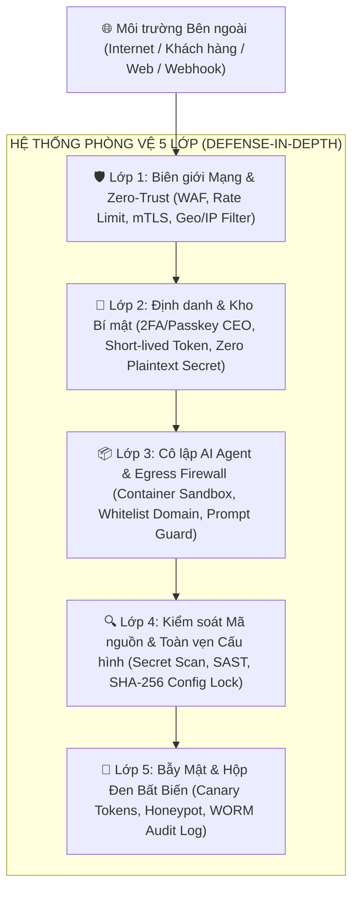
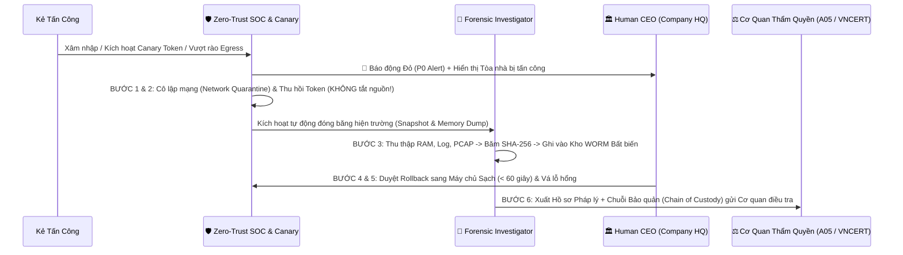

# Chiến Lược An Ninh Mạng, Phòng Vệ Đa Tầng & Quy Trình Thu Thập Bằng Chứng Pháp Lý (`DreamTech Cyber Defense & DFIR`)

> **Mục tiêu cốt lõi dành cho CEO:**  
> Trong mô hình công ty phần mềm lai AI (**DreamTech 3D/2.5D Hybrid Company**), hệ thống không chỉ đối mặt với các cuộc tấn công mạng truyền thống (DDoS, chiếm quyền máy chủ, đánh cắp dữ liệu) mà còn đối mặt với các cuộc tấn công thế hệ mới nhắm vào **AI Agents** (Prompt Injectfion, chiếm quyền công cụ dòng lệnh, rút cạn ngân sách API).  
> Tài liệu này thiết lập **Hệ thống Phòng vệ Chủ động (Defense-in-Depth)**, **Quy trình Ứng cứu Khẩn cấp (Incident Response)** và **Quy chuẩn Lưu giữ Dấu vết Số (Digital Forensics & Chain of Custody)** đảm bảo đầy đủ giá trị pháp lý khi bàn giao cho cơ quan có thẩm quyền.

---

## PHẦN 1: BIÊN CHẾ ĐỘI ĐẶC NHIỆM AN NINH MẠNG (`CYBERSECURITY & DFIR SQUAD`)

Trong không gian 2.5D của đảo **DreamTech**, Đội An ninh mạng hoạt động như một trung tâm **SOC & Forensics Vault** (liên kết trực tiếp giữa **🧪 QA Center**, **🏰 Cloud Castle** và **🏛️ Company HQ**):

| Vai trò / Agent ID | Chức danh trong Công ty | Nhiệm vụ Phòng vệ & Điều tra số |
| :--- | :--- | :--- |
| **Zero-Trust Sentinel** (`sec_blue_team`) | *Lead SOC & Perimeter Defender* | Giám sát lưu lượng mạng 24/7, quản lý tường lửa WAF, phát hiện bất thường (Anomaly Detection), kích hoạt cầu dao ngắt mạch (**Circuit Breaker**) khi có dấu hiệu tấn công. |
| **AppSec & AI Guardrail** (`sec_ai_guard`) | *DevSecOps & Agent Sandbox Auditor* | Quét mã nguồn (SAST/Secret Scan), kiểm soát quyền hạn của các AI Agent, chặn đứng các lệnh độc hại (*Prompt Injection*, đọc trộm `.env`, sửa file cấu hình hệ thống). |
| **Deception Specialist** (`sec_honeypot`) | *Canary & Threat Intelligence Agent* | Rải bẫy mật (**Canary Tokens / Honeypots**) trong hệ thống để phát hiện kẻ xâm nhập ngay từ giây đầu tiên và ghi hình toàn bộ hành vi của kẻ tấn công. |
| **Forensic Investigator** (`dfir_collector`) | *Digital Forensics & Evidence Keeper* | Chuyên trách **đóng băng hiện trường**, trích xuất RAM/Disk/Log bất biến, tạo mã băm `SHA-256` và niêm phong chuỗi bảo quản bằng chứng (**Chain of Custody**). |
| **Victor Đặng** (`legal_compliance`) | *Legal & Authority Liaison* | Chuẩn hóa hồ sơ trình báo sự cố theo đúng biểu mẫu pháp lý để gửi Cơ quan An ninh mạng (A05, VNCERT/CC) và đối tác hạ tầng (Cloud/ISP). |

---

## PHẦN 2: NHẬN DIỆN CÁC MỐI ĐE DỌA TẤN CÔNG TỪ BÊN NGOÀI (`THREAT MODEL`)

Để phòng vệ đúng chỗ, hệ thống phân loại rõ **2 nhóm tấn công chính** nhắm vào công ty:

### 1. Tấn công Hạ tầng, Web/API & Dữ liệu Truyền thống
- **Xâm nhập Trái phép & Chiếm quyền (Unauthorized Access / Account Takeover):** Dò mật khẩu (Brute-force), đánh cắp Session Cookie, OAuth Token hoặc khóa SSH/API Key bị lộ.
- **Khai thác Lỗ hổng Ứng dụng (Web/API Exploitation):** SQL Injection, Cross-Site Scripting (XSS), Server-Side Request Forgery (SSRF), Remote Code Execution (RCE) thông qua các cổng webhook hoặc trang quản trị.
- **Tấn công Từ chối Dịch vụ (DDoS / Resource Exhaustion):** Làm tê liệt máy chủ, làm tràn bộ nhớ RAM/CPU của các con bot chạy 24/7.
- **Ransomware & Phá hoại Dữ liệu:** Mã hóa cơ sở dữ liệu, xóa lịch sử Git hoặc cài cửa hậu (Backdoor).

### 2. Tấn công Đặc thù Nhắm vào Hệ thống AI Agent (`AI-Native Attacks`)
- **Indirect Prompt Injection (Tiêm lệnh gián tiếp):** Kẻ tấn công bên ngoài gửi một email, tạo một GitHub Issue, hoặc dựng một trang web chứa đoạn lệnh ẩn. Khi AI Agent (như `intake`, `ba`, hoặc `browser_agent`) đọc nội dung đó, Agent bị thao túng và tự động chạy lệnh gửi khóa bí mật (`.env`) ra máy chủ của hacker.
- **Privilege Escalation qua Công cụ Agent (Tool/Shell Abuse):** Lợi dụng quyền chạy lệnh terminal của `Senior Dev Agent` để cài mã đào tiền ảo hoặc mở cổng kết nối ngược (Reverse Shell).
- **Tấn công Đốt Tiền — Denial of Wallet (`DoW`):** Kích hoạt vòng lặp vô tận khiến các AI Agent gọi API LLM liên tục nhằm phá sản ngân sách token của công ty.
- **Đầu độc Chuỗi cung ứng (Supply Chain / Dependency Confusion):** Đẩy các gói thư viện giả mạo (`npm`, `PyPI`) hoặc can thiệp vào cấu hình linter/build.

---

## PHẦN 3: PHƯƠNG ÁN PHÒNG VỆ ĐA TẦNG (`DEFENSE-IN-DEPTH — 5 LỚP KHIÊN`)



### Lớp 1: Phòng vệ Chu vi & Mạng Zero-Trust (`Network & Perimeter`)
- **Ẩn toàn bộ dịch vụ nội bộ:** Không mở bất kỳ cổng quản trị, database hay dịch vụ nội bộ nào trực tiếp ra Internet công cộng. Mọi giao tiếp nội bộ bắt buộc đi qua đường hầm mã hóa (`WireGuard / Cloudflare Tunnel / Tailscale`) và xác thực bằng token riêng.
- **Tường lửa Ứng dụng Web (WAF) & Rate Limiting:** Tự động chặn các IP có hành vi quét cổng (Port Scan), gửi request vượt ngưỡng (ví dụ: `> 60 req/phút`) hoặc chứa payload SQLi/XSS.
- **Cầu dao Ngân sách & Tài nguyên (`FinOps & Infra Circuit Breaker`):** Tự động ngắt kết nối API ngay lập tức nếu chi phí tăng đột biến vượt trần (ví dụ: `$10/tháng` hoặc tiêu thụ quá `70%` hạn mức ngày) để chống tấn công *Denial-of-Wallet*.

### Lớp 2: Quản trị Định danh & Khóa Bí mật (`IAM & Secret Vault`)
- **Nguyên tắc Đặc quyền Tối thiểu (`Least Privilege`):**
  - Agent thiết kế (`ui_ux`) hoặc phân tích (`ba`) **chỉ có quyền đọc/ghi tài liệu**, tuyệt đối không có quyền chạy lệnh mạng hay truy cập kho khóa bí mật.
  - Chỉ **Human CEO** (xác thực qua **2FA / Passkey phần cứng**) mới có quyền bấm nút mở cổng `Production Deploy` hoặc thay đổi hạn mức tài chính.
- **Tuyệt đối không lưu Secret trong Code:** Mọi API Key, Token ngân hàng, Telegram Bot Token được cấp phát động vào bộ nhớ khi chạy và tự động hết hạn ngắn hạn (*Short-lived Tokens*).

### Lớp 3: Đóng Hộp Cát AI Agent & Kiểm soát Đầu ra (`Agent Sandbox & Egress Control`)
- **Cô lập bằng Git Worktree & Container:** Mỗi Agent làm việc trong một không gian tệp tin tách biệt hoàn toàn, không thể truy cập thư mục hệ thống của máy chủ gốc (`Host OS`).
- **Tường lửa Chiều ra (`Strict Egress Firewall`):** Máy trạm của Agent **chỉ được phép kết nối tới danh sách tên miền đã duyệt (Allowlist)** như `github.com`, `npmjs.org`, `googleapis.com`. Nếu một Agent bị tiêm mã độc và cố gắng gửi dữ liệu tới một IP lạ (`evil-server.com`), gói tin bị chặn đứng ngay tại tường lửa và kích hoạt báo động đỏ.
- **Bộ lọc Tách biệt Dữ liệu Không tin cậy (`Untrusted Input Sanitizer`):** Mọi dữ liệu lấy từ bên ngoài (email, web, ticket khách hàng) đều được bọc trong thẻ cách ly dữ liệu trước khi đưa vào LLM, ngăn chặn *Indirect Prompt Injection*.

### Lớp 4: Bảo vệ Toàn vẹn Mã nguồn & Cấu hình (`Code & Config Integrity`)
- **Khóa Cứng Các Tệp Nhạy Cảm (`Protected Config Lock`):** Hệ thống tính mã băm `SHA-256` cho các file cấu hình trọng yếu (`.eslintrc`, `tsconfig.json`, `package.json`, `.github/workflows/*`). Mọi hành vi tự ý sửa đổi cấu hình bảo mật đều bị chặn tự động ở bước `VERIFY`.
- **Quét Bí mật & Lỗ hổng Tự động:** Tích hợp công cụ quét Secret (`gitleaks`/`trufflehog`) và kiểm tra thư viện độc hại trước mỗi lần commit.

### Lớp 5: Hệ thống Bẫy Mật Cảnh Báo Sớm (`Canary Tokens & Deception`)
- Đặt các **"Mồi nhử Kỷ thuật số" (Canary Files / Honey Credentials)** tại các vị trí hacker thường tìm kiếm đầu tiên:
  - File giả `.env.production.backup` chứa AWS/API Key giả có gắn định danh theo dõi.
  - Bản ghi khách hàng VIP giả trong Database (Honey-record).
- **Cơ chế kích hoạt:** Nhân viên và Agent thật được cấu hình không bao giờ chạm vào các file bẫy này. Ngay giây đầu tiên kẻ tấn công đọc hoặc sử dụng API Key mồi nhử, hệ thống lập tức nhận được **IP thật, User-Agent, Thời gian và Vị trí truy cập** của kẻ tấn công trước khi chúng kịp chạm vào dữ liệu thật.

---

## PHẦN 4: PHƯƠNG ÁN ỨNG CỨU & KHẮC PHỤC KHI BỊ TẤN CÔNG (`INCIDENT RESPONSE PLAYBOOK`)

> [!CAUTION]
> **NGUYÊN TẮC VÀNG KHI PHÁT HIỆN BỊ TẤN CÔNG: "ĐÓNG BĂNG HIỆN TRƯỜNG TRƯỚC — XÓA/CÀI LẠI SAU"**  
> Sai lầm lớn nhất của nhiều công ty khi bị hack là **vội vàng tắt nguồn máy chủ (Reboot/Shutdown)** hoặc **xóa sạch cài lại máy ngay lập tức**. Hành động đó sẽ **vô tình xóa sạch dấu vết trong RAM, xóa kết nối mạng của hacker và làm mất giá trị pháp lý của bằng chứng**, khiến cơ quan chức năng không thể truy vết thủ phạm!

Khi có sự cố xảy ra, giao diện **DreamTech** chuyển sang trạng thái **`🚨 DEFCON 1 — INCIDENT MODE`** và thực hiện chính xác **6 bước chuẩn quốc tế (NIST SP 800-61 / ISO 27035)**:



### Bước 1: Phát hiện & Xác định Phạm vi (`Phút thứ 0 – 5`)
- Hệ thống tự động đánh dấu tòa nhà/phòng ban đang bị xâm nhập bằng **vòng cảnh báo đỏ chớp** trên bản đồ Đảo DreamTech.
- Tự động xác định: *Tài khoản/Agent nào bị chiếm quyền? Máy chủ/Container nào bị ảnh hưởng? Dữ liệu nào đã bị đọc?*

### Bước 2: Cô lập Tức thì Nhưng Giữ Nguyên Hiện trường (`Phút thứ 5 – 15`)
1. **Cách ly mạng (`Network Quarantine`), KHÔNG tắt máy:**
   - Ngắt kết nối Internet ra/vào của máy chủ hoặc container bị nhiễm bằng tường lửa, chỉ giữ lại 1 kênh quản trị nội bộ một chiều dành riêng cho công cụ điều tra số (`DFIR`).
   - Nếu là Container/VM: Dùng lệnh đóng băng trạng thái (`docker pause` hoặc `VM Snapshot` kèm bộ nhớ RAM) thay vì `docker rm` hay `shutdown`.
2. **Vô hiệu hóa Chìa khóa (`Credential Revocation`):**
   - Thu hồi và xoay vòng (Rotate) toàn bộ API Key, Session Token, SSH Key, Webhook Secret liên quan.
3. **Chuyển hướng Lưu lượng (`Traffic Failover`):**
   - Nếu dịch vụ khách hàng đang chạy, chuyển hướng DNS/Load Balancer sang môi trường dự phòng sạch để công ty không bị gián đoạn hoạt động.

### Bước 3: Thu thập Bằng chứng Số (`Phút thứ 15 – 60`)
- Chạy kịch bản tự động thu thập toàn bộ dấu vết theo đúng **Thứ tự Khả biến (Order of Volatility)** (chi tiết tại Phần 5 bên dưới) trước khi tiến hành dọn dẹp.

### Bước 4: Diệt trừ & Vá Lỗ hổng (`Eradication`)
- Sau khi đã có bản sao lưu bằng chứng (Forensic Image) hoàn chỉnh:
  - Phân tích cách thức kẻ tấn công đi vào (*Root Cause Analysis*: Lộ key? Lỗ hổng dependency? Prompt injection?).
  - Gỡ bỏ hoàn toàn mã độc, tài khoản lạ, cronjob ẩn, SSH authorized_keys trái phép.
  - Cập nhật bản vá bảo mật và thêm quy tắc chặn trên WAF.

### Bước 5: Khôi phục Hệ thống Sạch (`Clean Recovery < 60 giây`)
- Khởi tạo lại (Rebuild) môi trường từ **Immutable Infrastructure Code (IaC)** và khôi phục dữ liệu từ bản **Backup ngoại tuyến chống ghi đè (Air-gapped / Immutable Backup)**.
- Giám sát chặt chẽ trong 72 giờ tiếp theo để đảm bảo kẻ tấn công không còn cửa hậu.

### Bước 6: Cập nhật "Hệ miễn dịch" Công ty (`Post-Mortem -> Skill Map`)
- Mọi lỗ hổng vừa xảy ra được `Master Coach` (tại **🏠 HR House**) mã hóa thành **Luật Kiểm tra Tự động (Lint Rule / Security Test Case)** trong `skill-map-rules.yml` để toàn bộ đội ngũ không bao giờ mắc lại lần thứ 2.

---

## PHẦN 5: QUY TRÌNH LƯU GIỮ DẤU VẾT & ĐÓNG GÓI BẰNG CHỨNG GỬI CƠ QUAN CÓ THẨM QUYỀN

Để cơ quan công an / cơ quan an ninh mạng có thể **khởi tố, truy vết IP nhà mạng, hoặc yêu cầu quốc tế phối hợp**, bằng chứng điện tử do công ty cung cấp phải đảm bảo **tính khách quan, toàn vẹn (không bị chỉnh sửa) và rõ nguồn gốc** theo tiêu chuẩn **ISO/IEC 27037**, **RFC 3227** và quy định pháp luật hiện hành về dữ liệu điện tử.

### 1. Thứ Tự Ưu Tiên Thu Thập Dấu Vết (`Order of Volatility`)
Khi bấm nút **`[🧊 Thu Thập Bằng Chứng Pháp Lý]`**, hệ thống tự động gom dữ liệu theo thứ tự từ **dễ bay hơi nhất** đến **bền vững nhất**:

| Thứ tự | Loại Dấu vết Cần Thu thập | Chi tiết Nội dung Lưu giữ | Vì sao Cơ quan Điều tra cần? |
| :---: | :--- | :--- | :--- |
| **1 (Khẩn cấp nhất)** | **Bộ nhớ RAM & Tiến trình đang chạy (`Volatile Memory`)** | - Bản chụp RAM (`Memory Dump`)<br>- Danh sách tiến trình (`ps aux` / `Get-Process`)<br>- Các kết nối mạng đang mở (`netstat -antp`, cổng ngầm, IP đang kết nối trực tiếp) | Nhiều mã độc hiện đại (Fileless Malware) chỉ nằm trên RAM mà không ghi xuống ổ cứng. Tắt máy là mất trắng! |
| **2** | **Lưu lượng Mạng & Truy vết Đường truyền (`Network Traces`)** | - Bản ghi gói tin (`PCAP` chụp các gói tin vào/ra)<br>- Nhật ký WAF, Cloudflare/Nginx Access Logs, DNS Query Logs<br>- Đầy đủ: **Source IP, Source Port, Timestamp (UTC), HTTP Headers, User-Agent, TLS Fingerprint (JA3/JA4)** | Là căn cứ quan trọng nhất để Cơ quan điều tra tra cứu với nhà mạng (ISP/VNNIC) xem IP đó thuộc thuê bao nào vào đúng giây phút đó. |
| **3** | **Nhật ký Hoạt động Ứng dụng & AI Agent (`Application & AI Logs`)** | - Lịch sử xác thực (Auth logs: Đăng nhập thành công/thất bại)<br>- Toàn bộ chuỗi `Prompt Input -> Tool Call -> Terminal Command -> Output` của AI Agent bị thao túng<br>- Lịch sử `git reflog` & `git diff` | Chứng minh hành vi xâm nhập trái phép, phương thức thủ đoạn và ý đồ phá hoại/chiếm đoạt của kẻ tấn công. |
| **4** | **Bản sao Ổ đĩa Nguyên trạng (`Bit-by-Bit Disk Image`)** | - Bản chụp nguyên vẹn phân vùng ổ đĩa hoặc Container Layer (`dd` / `E01` / Snapshot)<br>- Bao gồm cả các vùng nhớ của file vừa bị kẻ tấn công xóa (Unallocated Space) | Giúp giám định viên kỹ thuật hình sự khôi phục các công cụ hack mà kẻ tấn công đã cố xóa sau khi gây án. |
| **5** | **Biên bản Thiệt hại & Hiện trạng (`Impact & Financial Evidence`)** | - Ảnh chụp màn hình có đóng dấu thời gian<br>- Hóa đơn API/Cloud bị đốt tiền, danh sách dữ liệu bị truy cập, thời gian gián đoạn dịch vụ | Cơ sở định khung thiệt hại vật chất để xử lý hình sự hoặc yêu cầu bồi thường thiệt hại / bảo hiểm. |

---

### 2. Bốn Kỹ Thuật Bảo Đảm Bằng Chứng Không Thể Chối Cãi (`Tamper-Proof Architecture`)

1. **Hộp Đen Lưu Trữ Bất Biến (`WORM — Write Once, Read Many`):**
   - Toàn bộ log hệ thống được đẩy theo thời gian thực (Real-time Streaming) sang một máy chủ Log độc lập hoặc Cloud Bucket bật chế độ **Object Lock (Compliance Mode)**.
   - **Đặc tính:** Chỉ cho phép ghi thêm (`Append-only`), cấm xóa và cấm sửa trong vòng ít nhất 1 năm. Ngay cả khi hacker chiếm được quyền `root` của máy chủ ứng dụng, chúng cũng **không thể xóa được nhật ký hành vi** đã gửi sang Hộp đen này.
2. **Băm Mật Mã Học Hai Lớp (`Dual Hash SHA-256 & SHA-512`):**
   - Ngay giây phút trích xuất bất kỳ file log, ảnh chụp hay bản dump nào, hệ thống lập tức tính toán mã băm `SHA-256` và `SHA-512` và lưu vào file `MANIFEST.sha256`.
   - Chỉ cần 1 dấu chấm hay 1 ký tự trong file bằng chứng bị sửa đổi, mã Hash sẽ thay đổi hoàn toàn $\rightarrow$ Chứng minh công ty hoàn toàn trung thực, không ngụy tạo bằng chứng.
3. **Đồng Bộ Thời Gian Chuẩn Quốc Tế (`NTP Stratum-1 + UTC ISO-8601`):**
   - Tất cả máy chủ, container và AI Agent bắt buộc đồng bộ đồng hồ qua giao thức NTP và ghi log theo múi giờ chuẩn **`UTC` (`YYYY-MM-DDTHH:mm:ss.sssZ`)** kèm múi giờ địa phương (`+07:00`).
   - *Lý do:* Nếu đồng hồ máy chủ lệch 5 phút, cơ quan công an khi đối chiếu với nhà mạng viễn thông sẽ tra ra nhầm người dùng khác!
4. **Sổ Giao Nhận Chuỗi Bảo Quản Bằng Chứng (`Chain of Custody Log`):**
   - Mỗi lần đóng gói hoặc bàn giao bằng chứng đều được ghi nhận: *Ai trích xuất? Vào giờ nào? Lưu ở thiết bị nào? Mã Hash lúc giao và lúc nhận có khớp nhau 100% không?*

---

### 3. Cấu Trúc Thư Mục Hồ Sơ Bằng Chứng Chuẩn (`Forensic Evidence Package`)

Khi xảy ra sự cố, hệ thống tự động đóng gói một thư mục niêm phong tại `.aise/forensics/INC-YYYYMMDD-XXX/` với cấu trúc sẵn sàng chép ra USB chuyên dụng (chống ghi) hoặc tải lên cổng tiếp nhận của cơ quan chức năng:

```text
📦 INC-20261110-001_DreamTech_Forensic_Package/
 ├── 📄 00_EXECUTIVE_INCIDENT_REPORT.pdf       # Báo cáo tóm tắt vụ việc (Dành cho Cơ quan Điều tra & CEO)
 ├── 📜 01_CHAIN_OF_CUSTODY_LOG.json           # Biên bản chuỗi bảo quản & Lịch sử niêm phong bằng chứng
 ├── 🔐 02_HASH_MANIFEST.sha256                # Danh sách mã băm SHA-256 của toàn bộ file trong gói
 ├── 🔐 02_HASH_MANIFEST.sha256.sig            # Chữ ký số (GPG/Timestamp) xác thực thời điểm tạo gói
 ├── 📂 03_NETWORK_TRACES/
 │    ├── attacker_traffic_capture.pcap        # Bản ghi gói tin mạng gốc
 │    ├── waf_and_reverse_proxy_access.log     # Log truy cập chứa IP thật, JA3 Fingerprint, URI
 │    └── egress_firewall_blocked_alerts.json  # Log chặn kết nối trái phép ra máy chủ của hacker
 ├── 📂 04_VOLATILE_MEMORY_AND_PROCESS/
 │    ├── memory_snapshot.dmp                  # Bản chụp bộ nhớ RAM tại thời điểm phát hiện
 │    ├── active_processes_and_sockets.txt     # Danh sách tiến trình & cổng mạng đang mở
 │    └── container_inspect_and_diff.json      # Các file bị kẻ tấn công thay đổi trong container
 ├── 📂 05_APPLICATION_AND_AI_AUDIT_LOGS/
 │    ├── immutable_auth_events.jsonl          # Lịch sử đăng nhập / Brute-force / Token usage
 │    ├── ai_agent_prompt_and_tool_trace.jsonl # Bằng chứng nếu hacker tấn công qua Prompt Injection
 │    └── canary_token_trigger_alert.json      # Dấu vết khi hacker sập bẫy Canary
 └── 📂 06_VISUAL_AND_DAMAGE_EVIDENCE/
      ├── screen_recording_and_screenshots/    # Ảnh chụp màn hình & trạng thái hệ thống
      └── financial_and_downtime_assessment.md # Bảng kê thiệt hại chi phí API / Gián đoạn dịch vụ
```

---

### 4. Danh Bạ Cơ Quan Có Thẩm Quyền & Mẫu Biểu Trình Báo Nhanh

Tuỳ thuộc vào phạm vi hoạt động và tính chất vụ việc, **CEO** cùng bộ phận **Pháp chế (`Victor Đặng`)** gửi bộ hồ sơ `Forensic Evidence Package` tới:

1. **Tại Việt Nam:**
   - **Cục An ninh mạng và phòng, chống tội phạm sử dụng công nghệ cao (Cục A05 — Bộ Công an)** hoặc **Phòng An ninh mạng (PA05 — Công an Tỉnh/Thành phố):** Giải quyết các vụ xâm nhập trái phép, chiếm đoạt dữ liệu, tống tiền (Ransomware), phá hoại hệ thống thông tin.
   - **Trung tâm Ứng cứu khẩn cấp không gian mạng Việt Nam (VNCERT/CC — Cục An toàn thông tin, Bộ TT&TT):** Điều phối ứng cứu sự cố, chặn lọc tên miền/IP độc hại diện rộng trên các nhà mạng Việt Nam (Viettel, VNPT, FPT).
2. **Quốc tế & Nhà cung cấp Hạ tầng (Khi IP tấn công từ nước ngoài):**
   - **Abuse Team của Nhà cung cấp Cloud / ISP** (AWS Abuse, Cloudflare Trust & Safety, DigitalOcean Abuse, Google Cloud Abuse) kèm file log `03_NETWORK_TRACES/` để yêu cầu khóa máy chủ C2 (Command & Control) của kẻ tấn công ngay lập tức.
   - **IC3 (FBI Internet Crime Complaint Center)** hoặc **CERT quốc tế** nếu ảnh hưởng tới khách hàng/đối tác tại Mỹ và châu Âu.

#### 📋 Mẫu Tóm Tắt Thông Tin Cốt Lõi Khi Gửi Cơ Quan Chức Năng (Trích xuất tự động từ UI):
- **Mã sự cố:** `INC-YYYYMMDD-XXX`
- **Khung thời gian xảy ra sự cố (Chuẩn UTC & Giờ địa phương):** Từ `...` đến `...` (Độ chính xác đồng bộ NTP: `< 10ms`)
- **Danh sách Địa chỉ IP / Domain nghi vấn của Kẻ tấn công:** `[IP_1:Port]`, `[IP_2:Port]`, `[ASN / Nhà mạng]`
- **Phương thức & Thủ đoạn tấn công (Attack Vector):** *(VD: Khai thác lỗ hổng Webhook / Brute-force / Tiêm mã độc qua Prompt)*
- **Hậu quả / Thiệt hại ghi nhận:** *(Số lượng bản ghi bị ảnh hưởng, chi phí phát sinh, thời gian gián đoạn)*
- **Cam kết Toàn vẹn Bằng chứng:** Toàn bộ dữ liệu đính kèm được trích xuất nguyên trạng từ Hệ thống Lưu trữ Bất biến (WORM) và kiểm chứng bằng mã băm **`SHA-256`** đính kèm tại tệp `02_HASH_MANIFEST.sha256`.

---

## PHẦN 6: TÍCH HỢP LÊN GIAO DIỆN 2.5D CHO CEO (`SECURITY HUD & 1-CLICK ACTIONS`)

Để CEO không cần phải gõ lệnh kỹ thuật lúc khẩn cấp, trên màn hình **🧪 QA Center**, **🏰 Cloud Castle** và **🏛️ Company HQ** được trang bị **4 Nút Bấm Phản Ứng Tức Thì (`1-Click Cyber Defense Actions`)**:

1. **`[🛡️ Bật Khiên Cô Lập (Quarantine Room)]`:** Cô lập mạng ngay lập tức đối với phòng ban/tác nhân có dấu hiệu bị xâm nhập nhưng vẫn giữ nguyên bộ nhớ để điều tra.
2. **`[🧊 Đóng Băng & Thu Thập Dấu Vết (Freeze & Collect Forensics)]`:** Tự động chụp RAM, trích xuất Log bất biến, chụp PCAP và đóng gói thành thư mục `INC-YYYYMMDD-XXX` kèm mã băm `SHA-256`.
3. **`[🔑 Xoay Vòng Toàn Bộ Khóa (Rotate All Secrets)]`:** Hủy toàn bộ API Key/Token cũ và cấp khóa mới cho các dịch vụ hợp lệ trong 5 giây.
4. **`[⚖️ Xuất Hồ Sơ Pháp Lý (Export Authority Report)]`:** Xuất file báo cáo PDF + gói bằng chứng nén có chữ ký số để gửi ngay cho Cơ quan điều tra (A05 / VNCERT).
